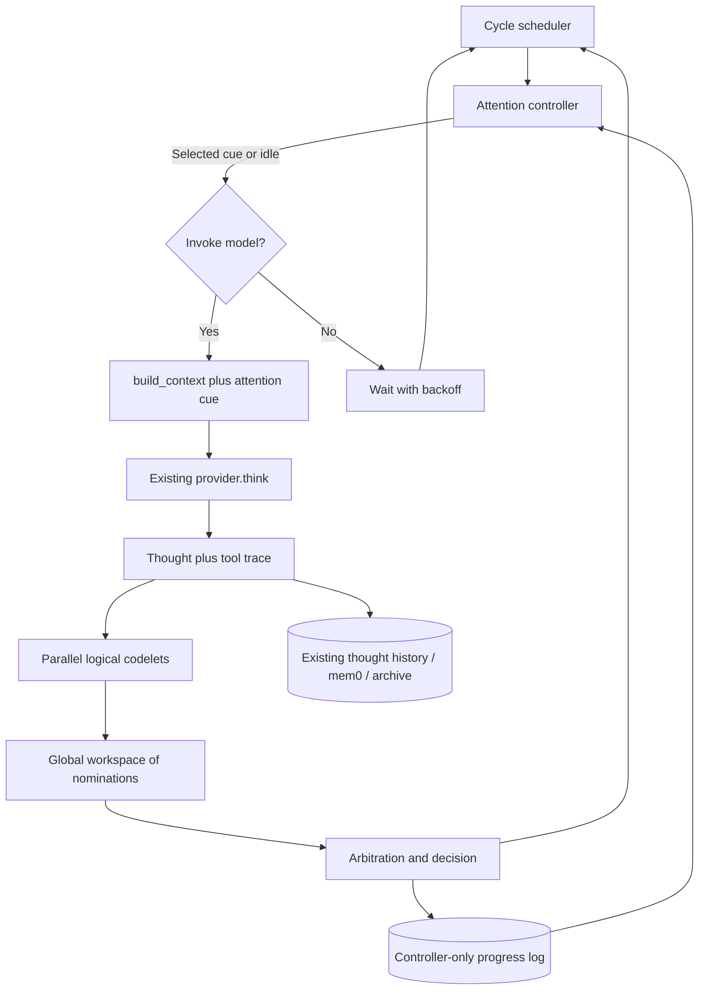

# Rumination Engine: LIDA-Inspired Attention Architecture Migration Plan

**Repository:** [BangRocket/rumination-engine](https://github.com/BangRocket/rumination-engine)  
**Target branch reviewed:** `master`  
**Status:** Implementation proposal; no repository changes made  
**Primary objective:** Improve **sustained productive reasoning** by separating reasoning from attention selection, while preserving spontaneous topic changes as a later experiment.

## 1. What the code does today

The engine already implements more than a bare LLM loop:

- [`ruminate.py`](https://github.com/BangRocket/rumination-engine/blob/master/ruminate.py) schedules cycles (`main()`), constructs context (`build_context()`), invokes the model, archives thoughts, and broadcasts to the dashboard/Discord.
- [`providers.py`](https://github.com/BangRocket/rumination-engine/blob/master/providers.py) offers Anthropic and OpenAI-compatible model adapters with streaming and agentic MCP tool calls.
- `set_next_prompt` writes `prompts/current.md`, so the model currently proposes its own next focus.
- MCP/mem0 already supports *persistent memory*. This is distinct from the proposed short-term, controller-only progress log.
- [`dashboard.py`](https://github.com/BangRocket/rumination-engine/blob/master/dashboard.py) exposes live SSE events and thought/prompt archives.
- `MAX_HISTORY` controls **number of previous thought texts**, not a token-budgeted complete transcript. The Python default is 10; [`docker-compose.yml`](https://github.com/BangRocket/rumination-engine/blob/master/docker-compose.yml) defaults to 2. Both provider implementations can trim history further on context-size errors.
- The model has powerful MCP and built-in tools, including self-source updates and restarts. Experiments need a controlled way to isolate attention changes from environmental changes.

**Key architectural weakness:** At present, the thinking model largely determines both the content of a thought *and* the next thought's agenda. Repeated deferral or narrow self-prompting can become self-reinforcing.

## 2. Scope and design choices

We are **borrowing LIDA's attention-codelet / competition / workspace ideas**, not claiming a complete implementation of the LIDA cognitive architecture. Keep the initial implementation in **Python**, to fit the repository. No second LLM or new database is required for the MVP.

1. Retain the existing provider, tool-use, identity/personality, memory, logging, and user-facing interfaces.
2. Add multiple small deterministic **codelets** that inspect a completed thought and nominate next actions.
3. Collect their nominations into a small **global workspace** and arbitrate which cue should become salient.
4. Let an **attention controller** choose `CONTINUE`, `REFRAME`, `REVISIT`, `EXPLORE`, or `IDLE` before the next model call.
5. Maintain **separate controller working state**: progress metrics, topic/question queues, cooldowns, and decisions. Do not expose all of this as conversation history.
6. Preserve model-authored `set_next_prompt` as **one candidate cue**, not a binding command that always wins.
7. Support an **observe-only** mode before interventions can affect behavior.

### Proposed flow



Codelets can run sequentially in-process. “Independent” describes separate evaluation responsibilities, not a need for threads, microservices, or additional model calls.

## 3. Proposed module boundaries

```text
ruminate.py                 # orchestration entry point; keep provider/MCP integration
providers.py                # unchanged in phase 1
attention/
    __init__.py
    models.py               # typed ThoughtEvent, Proposal, Decision, State
    codelets.py             # progress, repetition, contradiction, open-question
    workspace.py            # nominations and candidate cues for each cycle
    evaluator.py            # normalization, lightweight scoring, rolling statistics
    controller.py           # arbitration, transitions, cooldowns, idle policy
    storage.py              # append-only JSONL decision log, optional state snapshot
    context.py              # translate Decision into a narrow LLM cue
    config.py               # thresholds and feature flags
 tests/
    test_codelets.py
    test_controller.py
    test_context.py
    test_regressions.py
    fixtures/                # repetitive, productive, conflicting, empty outputs
```

The exact split can be simplified if it adds unnecessary indirection. Keep interfaces typed and provider-independent.

## 4. Codelet contracts and initial behaviors

Each codelet consumes a `ThoughtEvent` (completed thought, tool summary, current controller state, limited previous observations) and returns zero or more **proposals**:

```python
@dataclass(frozen=True)
class AttentionProposal:
    source: str                 # progress/repetition/contradiction/questions/self_prompt
    action: str                 # CONTINUE / REFRAME / REVISIT / EXPLORE / IDLE
    priority: float             # 0.0–1.0 (tunable)
    topic_key: str | None
    cue: str | None
    evidence: str               # observable reason for the recommendation
    confidence: float           # separately recorded, not treated as truth
```

- **Progress codelet:** Measures whether output adds a new hypothesis, test, conclusion, or substantial step. Initially use structural signals, nontrivial text changes, and tool results; don't trust the LLM's enthusiasm as evidence.
- **Repetition codelet:** Detects exact/near-duplicate thoughts and repeated deferral patterns using a rolling text window and simple similarity metrics. Avoid equating shared terminology with stagnation.
- **Contradiction codelet:** Initially flags only *high-confidence* conflicting structured assertions or explicit changes of position; semantic contradiction detection should remain advisory until validated.
- **Open-question codelet:** Extracts and tracks unanswered questions and unfinished next steps. Proposes `REVISIT` when a useful thread is not on cooldown. Start with heuristics or explicitly captured metadata rather than asserting that all questions can be extracted reliably.
- **Model-authored prompt proposer:** Converts `prompts/current.md` into a candidate cue. This preserves the existing `set_next_prompt` capability without giving it exclusive control of the next cycle.

**Possible future codelets:** Topic-diversity, curiosity, memory-association, resource-budget, and verified outcome/experiment codelets. Do not add them before establishing a baseline.

## 5. Arbitration and attention state

Use an MVP finite-state controller: `ENGAGED`, `REFLECTING`, `STALLED`, `IDLE`, `EXPLORING`, `SUSPENDED`.

- If useful progress continues, prefer `CONTINUE` and respect the current thread.
- If progress slows, try a bounded `REFRAME` once.
- If repetition or deferral persists, select an eligible `REVISIT` or `EXPLORE` cue rather than repeating the same unconstrained prompt.
- If there is no worthwhile candidate, choose `IDLE` and schedule a backoff **without spending model tokens**.
- If cost/time/manual stop limits are reached, enter `SUSPENDED`.

Use normalized priority, confidence, recency, and cooldown penalties; log all nominees and the winner. Support simple coalition rules (e.g. `repetition + open_question` favors `REVISIT`). Tie-breaking should be deterministic with an optional fixed random seed for reproducible tests. A hard global action/cost budget always overrides nominations.

Start conservatively: two substantial near-duplicate/deferral observations trigger **one** attempted redirection; if it fails, pause with exponential or capped backoff. Tune thresholds based on recorded cases, not intuition alone.

## 6. Changes to the existing loop

### `ruminate.py`

Currently `main()` calls `build_context(...)` and then `provider.think(...)`; afterwards it archives and appends the thought. Insert the controller at exactly those seams:

```python
controller = AttentionController(config)

while running:
    await scheduler.wait_until_due()
    decision = controller.before_cycle()
    broadcast("attention_decision", decision.as_dict())

    if decision.action == "IDLE":
        scheduler.backoff(decision.wait_seconds)
        continue
    if decision.action == "SUSPENDED":
        break

    system, messages = build_context(thought_history, tool_names, thought_count)
    messages = apply_attention_cue(messages, decision)
    thought, tool_trace = await provider.think(...)

    archive_and_broadcast(thought, tool_trace)
    event = ThoughtEvent(thought=thought, tool_trace=tool_trace, ...)
    proposals = codelets.evaluate(event, controller.state)
    controller.after_cycle(event, proposals)
```

The pseudocode expresses responsibilities rather than a drop-in patch. In particular, handle the **first cycle** (no prior event), provider failures, voluntary stop, intentional restart, and shutdown cleanup.

### `build_context()` and self-prompting

- Inject **one clear controller-selected cue** for the next thought; avoid stacking conflicting `[Continue]`, self-prompt and redirect instructions.
- When `ATTENTION_MODE=off`, preserve existing `build_context()` behavior exactly.
- Under active attention, retain model-authored prompts in storage but allow arbitration to override or defer them with a logged reason.
- Make the thought-history window configurable by **token budget**, with optional compact summaries. Do not assume `MAX_HISTORY=10` means full history. Keep mem0 retrieval distinct and provenance-aware.

### `providers.py`

Keep both implementations untouched in the initial migration. They already accept system/messages plus tool dispatcher. Later, optionally expose usage/latency/token counts and structured provider error categories to the evaluator.

### `dashboard.py` and `static/dashboard.html`

Add `attention_state`, `codelet_proposals`, and `attention_decision` SSE events, and a compact view showing state, cue, priority/evidence, consecutive deferrals, and cooldown. Preserve existing thought streaming and prompt history endpoints.

### Configuration

Add an opt-in flag and bounded defaults:

```env
ATTENTION_MODE=off           # off | observe | active
ATTENTION_DUPLICATE_WINDOW=5
ATTENTION_DEFERRAL_THRESHOLD=2
ATTENTION_IDLE_BACKOFF_SECONDS=120
ATTENTION_MAX_CONSECUTIVE_REDIRECTS=1
ATTENTION_LOG_PATH=./logs/attention.jsonl
ATTENTION_RANDOM_SEED=7
```

Use a controller-specific state directory or JSONL log; do not conflate attention state with mem0's autobiographical/semantic memory.

## 7. Step-by-step implementation / PR sequence

### PR 0 — Baseline and regression harness

- Record actual thought loop, tool interactions, context-size behavior, and current outcome patterns.
- Introduce pytest and fixtures for productive reasoning, near-duplicates, self-deferrals, unanswered questions, failed API calls and tool loops.
- Add token/cost/time caps and a reproducible sampling configuration for comparisons.
- Keep self-source edits/restarts **disabled or separately tracked during benchmarks**, otherwise the experiment changes its own control group.

**Done when:** Old behavior remains unchanged and captured baseline runs can be replayed.

### PR 1 — Observation-only codelets

- Introduce `ThoughtEvent`, `AttentionProposal`, codelets, progress log and an `ATTENTION_MODE=observe` flag.
- After each thought, run codelets and log recommendations without changing the following model prompt.
- Review false repetition/contradiction positives manually.

**Done when:** The observability layer works for both providers, adds no extra model calls, and never changes control flow in observe mode.

### PR 2 — Global workspace and controller

- Implement candidate selection, priorities, cooldowns, arbitration, explicit state transitions and `IDLE` backoff.
- Convert existing `set_next_prompt` into a proposal source; preserve stored prompts and explain override decisions in logs.
- Inject selected cues through a single context-building seam.
- Keep `ATTENTION_MODE=active` opt-in; fail open to the legacy flow if controller evaluation errors.

**Done when:** A repetitive fixture redirects or idles; a productive fixture continues; disabling the feature restores baseline behavior.

### PR 3 — Visibility, tuning and small experiments

- Add SSE events and dashboard attention panel.
- Run 20–50 short paired experiments with identical initial seeds, model, budgets and approximate sampling settings.
- Measure useful progress per token, longest deferral streak, false interruptions, topic depth, idle time, latency and cost.
- Manually rate sampled outputs so the evaluator doesn't merely reward longer or more confident text.

**Done when:** We can explain every intervention and show whether it improved results under controlled conditions.

### PR 4 — Optional memory-assisted cue generation

- If trials justify it, allow controller-side retrieval of mem0 memories or archived unresolved threads.
- Treat memory snippets as **candidate cues**, with timestamps/provenance, not automatic instructions.
- Keep autonomous file/system modification and new MCP tool permissions separate from attention selection.

**Done when:** Memory helps without contaminating the context, increasing repetition, or enabling unreviewed actions.

## 8. Test matrix and acceptance criteria

| Scenario | Expected behavior |
|---|---|
| Thought adds a concrete new test/idea | Remain `ENGAGED`; continue |
| Same assertion paraphrased three times | Detect likely repetition; reframe/redirect |
| Two consecutive “nothing to think about” responses | Offer one eligible cue, then back off if unproductive |
| Explicit unresolved question exists | May `REVISIT` instead of inventing unrelated content |
| Conflicting opinion supported by new evidence | Flag possible contradiction **without** automatic rejection |
| No meaningful cue available | Enter `IDLE`; no provider invocation during backoff |
| `set_next_prompt` suggests a useful task | Competes fairly and often wins |
| Controller throws an exception | Log the fault and fall back safely to previous behavior |
| Context window pressure | Deterministic history trimming/summarization; no silent data loss beyond documented policy |
| `ATTENTION_MODE=off` | Legacy behavior preserved |

**Decision criterion:** Promote active attention only if it reduces unproductive loops and improves human-rated useful progress **per token**, without unacceptable false interruptions or increased unauthorized actions.

## 9. What NOT to do yet

- Don't port the codebase to JavaScript: it's already Python 3.12 and the model-provider adapters are serviceable.
- Don't add an extra LLM evaluator until heuristics have demonstrable limits.
- Don't implement all of LIDA (perceptual memory, full cognitive cycle, learning machinery) just to test attention competition.
- Don't force the LLM to create substantive text every scheduler tick.
- Don't mix controller state, external memories and speculative model outputs into one unverified pool.
- Don't modify the live deployment or the `master` branch as part of drafting this plan.

## 10. The first concrete task

**Begin with PR 0 + PR 1:** Add a passive progress/repetition/open-question/contradiction monitor to the present loop, capture attention proposals in JSONL, and add tests built from real examples of the deferral loop. Only after seeing actual scores should we authorize intervention.

This is a falsifiable experiment: does independent attention management improve a system already capable of iterative thought?
